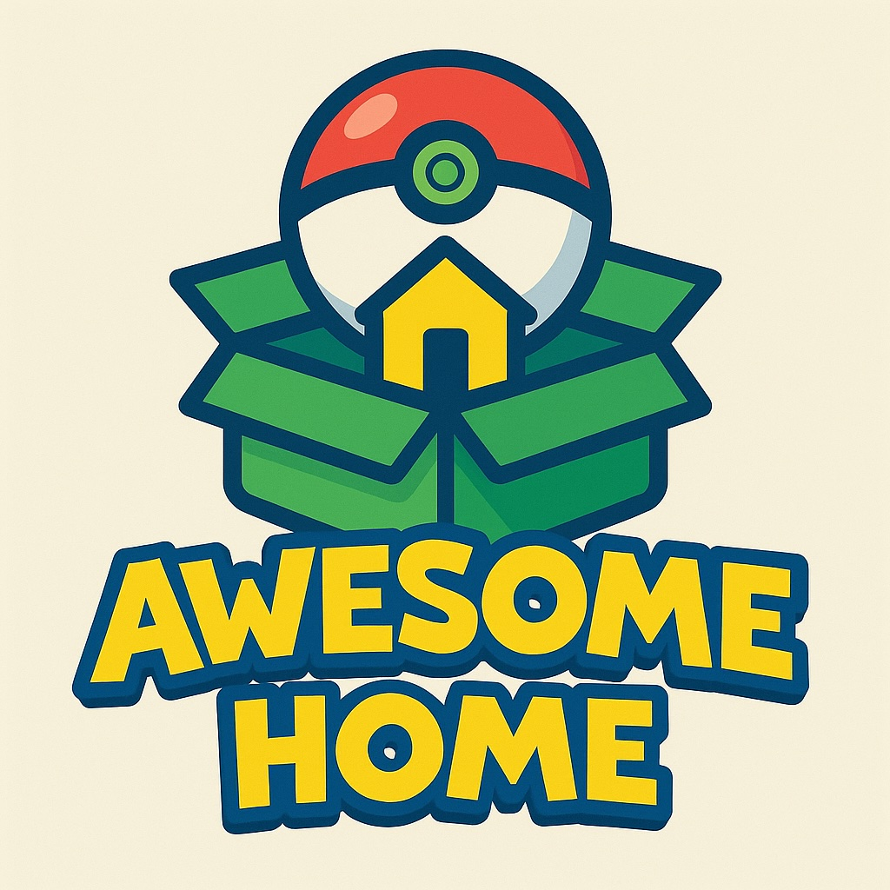

# Awesome Pokémon HOME 

  

> A curated list of resources, guides, tools, and communities for Pokémon HOME users. This is still a work in progress, started in November 23rd, 2024. Enjoy seeing it update randomly by [@lexrodba](http://twitter.com/lexrodba).

## Contents

- [How to use this guide](#how-to-use-this-guide)
- [Glossary](#glossary)
- [Free vs. Premium: which plan do I need?](#free-vs-premium-which-plan-do-i-need)
- [FAQ](#faq)
- [Completing the Main Pokédex](sections/main-pokedex.md)
- [Completing Game-Specific Pokédexes](sections/games.md)
  - [Pokemon Scarlet & Violet](sections/games.md#pokemon-scarlet--violet)
  - [Legends Arceus](sections/games.md#legends-arceus)
  - [Pokemon Brilliant Diamond & Shining Pearl](sections/games.md#pokemon-brilliant-diamond--shining-pearl)
  - [Pokemon Sword & Shield](sections/games.md#pokemon-sword--shield)
  - [Let's Go Pikachu/Eevee](sections/games.md#lets-go-pikachueevee)
  - [Pokemon Legends Z-A](sections/games.md#pokemon-legends-z-a)
  - [Pokemon Go](sections/games.md#pokemon-go)
- [Transfer rules & one-way traps](sections/transfers.md)
- [Box Organization](sections/boxes.md)
- [Trading](sections/trading.md)
- [Challenges](sections/challenges.md)
- [Official resources](#official-resources)
- [The basics](#the-basics)
- [Tools and utilities](#tools-and-utilities)
- [Communities and forums](#communities-and-forums)
- [Contributing](#contributing)
- [License](#license)

## How to use this guide

I am writing this guide as a braindump of all I know about Pokémon Home. You will find useful information like how to complete the Pokédex for each games, how to build living dexes, how to trade efficiently, do's and don'ts and amusing information like a section of Pokémon with fun names I've come across.

I have divided this guide into the subsections listed in [Contents](#contents) above, and then you'll find other sections with useful resources at the end of it.

## Glossary

New to Pokémon HOME or just my shorthand? Here are the terms that show up throughout this guide.

| Term | What it means |
| --- | --- |
| **'mon(s)** | Shorthand for Pokémon. Used all over this guide. |
| **Pokémon HOME** | The cloud app this guide is about — it stores your Pokémon and moves them between the main games. |
| **National Pokédex** (National Dex) | The master list of every species across all games — 1025 at the last update. |
| **Living Dex** | A collection where you actually *keep* one of every species stored at once, not just registered. |
| **GTS (Global Trading System)** | HOME's worldwide trading feature. You can park, search for, or offer 'mons. |
| **Parking** | Depositing a 'mon in the GTS with a set request and waiting for someone to fulfil it. |
| **Wonder Box** | A trade feature where you drop 'mons in and they get swapped at random with other players. |
| **Room Trade** | Trading inside a room of up to 20 people, one 'mon at a time. |
| **Friend Trade** | A direct trade with someone on your HOME friend list. |
| **Trade fodder** | Common or duplicate 'mons you keep around specifically to trade away. |
| **Brute-forcing** | Grinding lots of low-effort trades (usually Wonder Box) until dex entries and challenges fill up on their own. |
| **Premium Plan** | HOME's paid subscription — more storage (up to 6000), a bigger Wonder Box (10 vs 3), room hosting, etc. |
| **Shiny** | A rare alternate coloration of a Pokémon. |
| **Legendary / Mythical** | Rare, powerful species; Mythicals are usually event-only. |
| **Nature** | A trait that raises one of a 'mon's stats and lowers another. |
| **Pokérus** | A rare, beneficial "virus" that boosts stat growth; it doesn't wear off while a 'mon sits in HOME. |
| **Mega Evolution / Mega Stone** | A special battle form (central to Legends: Z-A's Mega Pokédex), triggered by a species-specific Mega Stone. |
| **Breeding / Ditto** | Producing eggs at the Nursery to get a species; Ditto breeds with almost anything, so it's the universal partner. |
| **Touch trade** | Briefly trading a 'mon just to register it in your dex, then trading it back — so it isn't truly yours. |
| **Mystery Gift** | The feature for claiming distributed 'mons or items via codes or events. |
| **Transporter** | The GO Transporter link that moves 'mons one-way from Pokémon GO into HOME. |
| **DLC** | Paid expansion content, like Scarlet/Violet's *The Teal Mask* and *The Indigo Disk*. |

## Free vs. Premium: which plan do I need?

You can get a long way on the **free (Basic) plan**, but the **Premium** subscription (a yearly purchase through the Nintendo eShop) removes the limits that hurt collectors most. These are the differences that actually matter for this guide — see the [official site](https://home.pokemon.com/) for the complete comparison.

| What you get | Basic (free) | Premium (paid) |
| --- | --- | --- |
| Pokémon you can store in HOME | 30 | 6,000 |
| Wonder Box deposits at once | 3 | 10 |
| Room Trade | Join existing rooms | Join **and** host your own rooms |

If you're seriously chasing a living dex or trading a lot, Premium is worth it — 30 slots fills up almost immediately.

## FAQ

**Do I need Premium?**
No — you can complete dexes on the free plan. But the 30-Pokémon storage limit fills up fast, so if you're collecting seriously, [Premium](#free-vs-premium-which-plan-do-i-need) (6,000 slots) is well worth it.

**What's the cheapest set of games to finish the National Dex?**
The minimum is Scarlet & Violet (with both DLCs), Legends: Arceus, Sword *or* Shield, Brilliant Diamond *or* Shining Pearl, and Let's Go Pikachu *or* Eevee. See the [full table](sections/main-pokedex.md#ready-lets-go).

**Can I get Mythicals through trading?**
Some, occasionally — the odd one turns up via GTS or Wonder Box generosity. But many Mythicals (like Magearna) can't be obtained through normal trades and require their specific event or game. Don't count on trading for them.

**Is Pokémon GO's dex completable?**
No. It's the only National Dex in HOME that currently **can't** be finished, because some species haven't been released in GO yet and others are event-locked. See the [Pokémon GO section](sections/games.md#pokemon-go).

## Official resources

- [Pokémon HOME Official Website](https://home.pokemon.com/)
- [Pokémon HOME Support Center](https://support.pokemon.com/hc/en-us/categories/360001984231-Pok%C3%A9mon-HOME)

## The basics

- [Pokémon HOME Explained - How To Transfer All Pokémon To And From Pokémon HOME](https://www.nintendolife.com/guides/pokemon-home-explained-how-to-transfer-all-pokemon-to-and-from-pokemon-home)
- [How to Transfer Pokémon to HOME](https://www.ign.com/wikis/pokemon-home/How_to_Transfer_Pokemon_to_HOME)
- [Serebii - Pokémon HOME](https://www.serebii.net/home/) - Exhaustive reference for HOME features, compatibility and Pokédex data.
- [Bulbapedia - Pokémon HOME](https://bulbapedia.bulbagarden.net/wiki/Pok%C3%A9mon_HOME) - Community wiki article covering HOME in depth.

## Tools and utilities

- [Pokémon HOME Mobile App](https://play.google.com/store/apps/details?id=jp.pokemon.pokemonhome) - Android version.
- [Pokémon HOME Mobile App](https://apps.apple.com/app/pok%C3%A9mon-home/id1485352913) - iOS version.
- [Pokémon GO](https://pokemongolive.com/) - Mobile game compatible with Pokémon HOME.
- [List of Pokémon by National Pokédex number](https://bulbapedia.bulbagarden.net/wiki/List_of_Pok%C3%A9mon_by_National_Pok%C3%A9dex_number) - Handy checklist when building a living dex.
- [Bulbapedia - Challenge (HOME)](https://bulbapedia.bulbagarden.net/wiki/Challenge_%28HOME%29) - Full list of HOME challenges and their requirements.

## Communities and forums

- [r/PokemonHome](https://www.reddit.com/r/PokemonHome/) - Subreddit dedicated to Pokémon HOME discussions.
- [r/pokemontrades](https://www.reddit.com/r/pokemontrades/) - Long-running subreddit for legitimate Pokémon trading.
- [r/CasualPokemonTrades](https://www.reddit.com/r/CasualPokemonTrades/) - More relaxed trading community, good for dex-filling swaps.
- [r/pokemon](https://www.reddit.com/r/pokemon/) - The main Pokémon subreddit for general discussion.

## Contributing

Spotted something out of date, or have a tip worth adding? Contributions are welcome — see [CONTRIBUTING.md](CONTRIBUTING.md) for what belongs here and how to submit a pull request. This guide is public domain, so your additions help everyone.

## Changelog

- **July 2026** — Corrected the Scarlet/Violet DLC names, fixed broken cross-section links and README anchors, deduplicated the table of contents, localized all images into `assets/`, and fixed assorted typos.
- **April 2026** — Added Pokémon Legends: Z-A section with HOME 4.0.0 compatibility notes, transfer caveats, Mystery Gifts, Champions promotion, and Mega Evolution Pokédex details.
- **January 2026** — Updated game-specific Pokédex guides and main Pokédex notes.
- **June 2025** — Updates to box organization and README.
- **May 2025** — Expanded trading section; updated challenges.
- **January 2025** — Updated games and box organization sections.
- **December 2024** — Updates across trading, main Pokédex, and README.
- **November 2024** — Initial release. Sections created: main Pokédex, game-specific Pokédexes, box organization, trading, challenges.

## License

