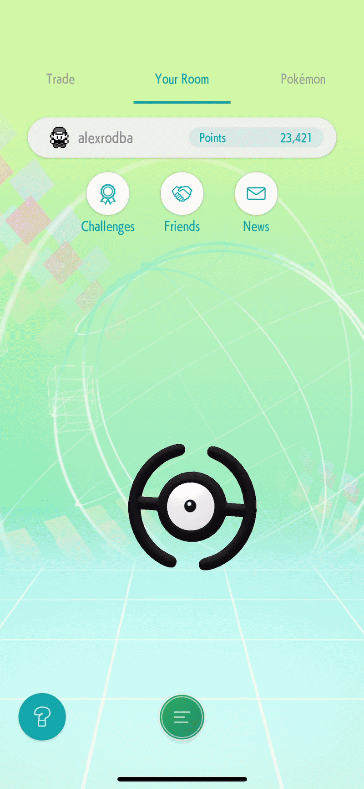
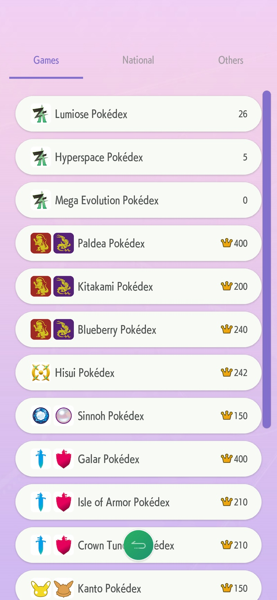

# How to complete the games-specific Pokédex

_Last updated: April 2026. See the [changelog](../README.md#changelog) for the full history._

So you've completed every dex in every game you own, and you feel like you've accomplished everything... but not! Pokémon Home has its own versions of the national Pokédex.

You can complete the in-game Pokédex of any game by transfering over 'mons from any game so they register (ok, there are a few exceptions, like you're not able to bring in Nincada nor Spinda into Pokémon Shining Pearl / Brilliant Diamond, [and other exceptions](https://comicbook.com/gaming/news/pokemon-home-spinda-nincada-gigantamax-pikachu-eevee/)), but to complete a National dex on Pokémon Home, you have to catch/hatch every species in that game.

Congratulations, you're in for a new level of trouble. But fret not, I am here to help you!

First off, how to get to that section of Pokémon Home:

  

As you can see, mine are all complete except for Pokémon Go's. Its dex can't be completed because a lot of species haven't been released in-game yet, or they've been made event-exclusive.

Now, how do you complete the National Dexes? Again, you have to get a species that has been originally obtained in that specific game.

Most Pokémon species on a given National dex will be catchable in that specific game. If not, they have be be obtained through [breeding](https://bulbapedia.bulbagarden.net/wiki/Pok%C3%A9mon_breeding). And last, you can obtain others by trading (especially, the game-exclusive).

Here's the quick version before the war stories below:

| Game | Difficulty | Trading activity | Trickiest to get |
| --- | --- | --- | --- |
| Scarlet & Violet | Easiest | Very active | Blueberry Terrarium starters |
| Legends: Arceus | Easy (and fun) | GTS-friendly | Cranidos, Shieldon |
| Brilliant Diamond & Shining Pearl | Hardest | Almost none | Trade-evolutions (e.g. Gengar); shares 'mons with Legends: Arceus |
| Sword & Shield | Medium (lots of 'mons) | Active | Galarian Slowbro/Slowking (Galarica items) |
| Let's Go Pikachu/Eevee | Medium | None found in-game | Re-registering Kanto starter stages; slow spawns (Clefable) |
| Legends Z-A | New, limited pool | Expected lively at launch | Mega Pokédex (syncs from your save, not transfers) |
| Pokémon Go | Can't be completed | N/A | Unreleased/event-locked species, Spinda |

I'll tell you how I did it with each of the games.

## Pokemon Scarlet & Violet

This one was probably the easiest one, as it's the most recent game, so in-game trading is very active (compared to other games). I was able to catch most of the 'mons inside the game.

As for the game-exclusives, I used [in-game trading using these codes](https://primagames.com/tips/best-pokemon-scarlet-and-violet-trade-codes), and I completed the dex fairly quickly.

The only tricky part I remember was getting all of the starters that you can get by unlocking extra species in the Blueberry Terrarium, even though I got some through trading on Pokémon Home itself.

Also, you can fill most of this national dex using brute force purely through Wonder Box trading. Most trades nowadays come with Pokémon from Paldea, as it's the most popular game, so give it enough time and you'll see that you can get to 80% of the national dex easily by purely using this method.

## Legends Arceus

Probably the most fun, for me. I loved this game, so it felt fantastic to have yet another reason to load it and immerse myself in the land of Hisui.

In legends Arceus, there's no egg hatching, so you have to rely on catching and trading. However, one good thing about this game, is that no single species evolves exclusively through trading, so this means you can get Gengar, Alakazam, Machamp, Golem, Scizor, Steelix, Magmortar, Electivire and Porygon-Z using in-game items you acquire with Merit Points. You can also evolve them via trading, but I found it faster to do it via items, since I had a lot of them already.

In fact, Alakazam/Gengar/Machamp/Golem are easily tradeable for each other using Pokémon Home's GTS, so if you do a bunch of trades, with enough patience you'll get these 'mons in a day or two.

I only had a bit of trouble catching extremely rare 'mons like Cranidos and Shieldon, if I recall correctly, but nothing to write home about.

## Pokemon Brilliant Diamond & Shining Pearl

Now, this was my most difficult to complete. The game fanbase isn't very active, so trading is almost non-existent, and also, to be honest, it was a pretty rubbish remake so I understand why not a lot of people are playing it.

I suffered quite a bit to complete this one because it shares too many 'mons with Legends Arceus, so every time I'd request a species for this National Dex, I'd get a 'mon caught in Legends Arceus.

Luckily, with a combination of brute force and breeding, I got most of my 'mons.

I struggled to get a Gengar via trading, so I caught a Gastly, brought it into Legends Arceus, evolved it into Gengar and brought it back to Home. It does the trick, as it takes into consideration the initial game where this 'mon was caught/hatched, not where it has been evolved.

For game exclusives, I simply brought in the specific species from another game and bred it with a Ditto at the Nursery. Remember [these tips](https://primagames.com/tips/best-pokemon-scarlet-and-violet-trade-codes) to have your eggs hatch faster.

## Pokemon Sword & Shield

Not a particularly difficult game, it's just that there are A LOT of 'mons here, too. 400 in the main games, and 210 in each DLC.

I obtained the starters using trading in the game with some brought-ins from Pokémon Go, and I did exactly the same to get the game exclusives. Others that evolve by trading can be found in the wild or in raids, like Machamp and Steelix.

On Isle of Armor, the only somewhat tricky are Galarian Slowbro and Slowking because they require collecting many Galarica Twigs to make the items they need to evolve. Well, you can do that, or you can ask them in Home's GTS in exchange for something slightly rare, like a Huntail/Gorebyss or their Kanto counterparts, as there's a Home challenge that you can complete with this trade.

On Crown Tundra, I did the trick of bringing Electabuzz and Magmar into Legends Arceus to evolve them there, and bring them back to complete this National Pokédex. The rest was also a walk in the park.

## Let's Go Pikachu/Eevee

I took some time to complete this National Dex mostly because I didn't remember how awkward the catching system was on this game. My joycons maybe aren't calibrated well, so I spent too many balls throwing off target.

There aren't any extremely tricky species to catch here, but it's easy to miss some.

For instance, because you get a Squirtle, Charmander and Bulbasaur in the game, the most likely scenario is to have evolved them to their final stages before bringing them to Home, so you won't have registered stage 1 nor stage 2 in Home. Luckily for me, through GTS I had gotten the first stages, so I only needed to get another copy of Squirtle, Bulbasaur and Charmander to bring them into another game to evolve them to Charmeleon, Wartortle and Ivysaur. Annoying, but not hard.

In these games, there's trading (I tried it to no avail - never found a valid trading counterpart) but there's no egg breeding.

In order to get Alakazam, Gengar, Machamp and Golem, I had to get their stage 1 mons, bring them to Legends Arceus and evolve them using an item. Maybe one or two of them I got via GTS, too, which shouldn't take more than 15-20 trades.

Outside of that, nothing really difficult, but some 'mons take ages to appear, so stock up on Repels and Lures to get that pesky Clefable.

## Pokemon Legends Z-A

HOME compatibility for Z-A landed with the version 4.0.0 update on April 2nd, 2026, and it's the odd one out: it doesn't behave like any other supported game, so read the caveats before you transfer a single 'mon.

### What you can and can't do

You **can**:

- Transfer 'mons from your Z-A team into HOME.
- Bring select 'mons from past titles into Lumiose City through HOME.
- Send Z-A 'mons to Pokémon Champions (which released on April 8th, 2026).

You **cannot**:

- Send Z-A 'mons back to any previous game (Scarlet/Violet, Sword/Shield, Legends: Arceus, and so on).
- Undo bringing a past-title 'mon into Z-A: the moment you do, it permanently loses the ability to return to those earlier games. Be careful with this one.

  

### The three Pokédexes

Z-A brings three of them: the Lumiose Pokédex, the Hyperspace Pokédex (the DLC one) and the Mega Evolution Pokédex.

The first two are same old, same old: mass transfer your 'mons from Z-A to Home, save, and bring them back so the entries get marked.

The Mega Evolution Pokédex is the weird one, so it gets its own section below.

### The Mega Evolution Pokédex

Here's the twist: you don't transfer anything to fill this one. The entries come from syncing your Z-A save with HOME, not from mega-evolving a 'mon in battle and shipping it over.

When you connect your Z-A save to Pokémon HOME, the game sends your Mega Evolution data back to your account. An entry counts as "completed" once that Mega Evolution is registered in your Z-A Pokédex — meaning you either have both the Pokémon and its Mega Stone in Z-A, or you've mega-evolved it at least once in-game.

So what you actually have to do is:

1. Beat the Z-A story content that unlocks Mega Evolution (the Lumiose City side content, etc.).
2. Get the Mega Stone for that Pokémon, either through the story or from shops like Quasartico Inc. / Stone Emporium.
3. Hold both the Pokémon and its Stone. That unlocks the entry in Z-A's Pokédex, and it'll show up in HOME's Mega Evolution Pokédex once your accounts sync.

One nuance: you don't have to transfer every mega-evolved 'mon to HOME to complete the dex, because HOME pulls the mega-evolution "stamp" straight from your save. But if you want to actually _see_ a specific Mega form in HOME (say, Shiny Mega Charizard X), you'll still need to transfer at least one base-form 'mon that can mega-evolve.

### Mystery Gifts

Deposit any Z-A 'mon into the Nintendo Switch version of HOME, then open the Mystery Gift tab on the mobile app to claim Alpha Chikorita, Alpha Tepig and Alpha Totodile.

There's also an alternate-form Magearna you can only get in HOME. Transfer it to Z-A and, if you've got the Magearnite and the Mega Dimension DLC, you can Mega Evolve it. Mega Magearna (Original Colour Form) gets its own Pokédex entry — it's the last Mega Evolution available in the game.

### Champions promotion

Send a Chesnaught, Delphox, Greninja or Eternal Flower Floette that you _caught in Z-A_ over to Pokémon Champions, and you'll get the matching Mega Stone there (Chesnaughtite, Delphoxite, Greninjite, Floettite). They have to be Z-A-caught — the same species from any other game won't cut it.

### Completing the Z-A National Dex

This dex is brand new as of the update. The species pool is limited to whatever can show up in Z-A, so it should be a lot more contained than Paldea or Galar. Expect trading to be lively in the weeks right after the HOME update — that's your window to grab version-specific or rare species through GTS.

## Pokemon Go

Again, this one still can't be completed — it remains the only National Dex in HOME you can't finish.

Some 'mons haven't been released, specially those from the latest generations (Paldea and Galar have been partly released) and there are some others that can't be found.

- Spinda can't be transferred from Go into Home.
- Some regionals might be hard to catch (I won't travel to the other side of the world to get a Pachirisu nor a Relicanth, I'm sorry), but I could get them via GTS (it's just extremely unlikely).
- Some are event-specific, like Rotom or Shiny Diancie.

The list above isn't exhaustive by any means.

This one doesn't bother me too much. It's just annoying that it's the only one left incomplete in my page of National Dexes, but it is what it is!

