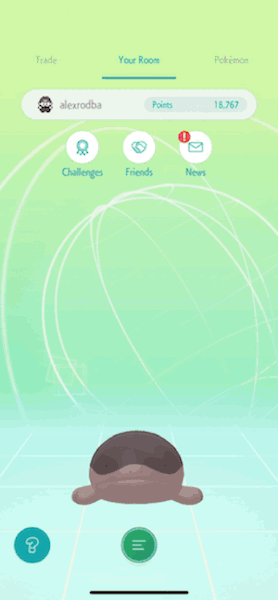
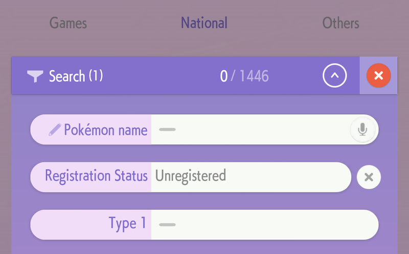

# How to complete the main Pokédex

_Last updated: October 2026. See the [changelog](../README.md#changelog) for the full history._

Alright, we all want to be the best like no one ever was.

The first big challenge is to complete the main Pokédex. This means registering each and every species there is - 1025 Pokémon as of this guide's last update, after the release of the Pokémon Scarlet and Violet DLCs.

Legends Z-A has since added its compatibility as well. It introduced no new species, but there's the Floette Eternal Flower form and three new Pokédex sections.

FireRed and LeafGreen on Nintendo Switch joined in October 2026 with HOME 4.1.0. They add no new species either, but anything registered in their Pokédex counts in HOME too, no transfer needed. Moving 'mons out is one-way, though, so check the [FireRed & LeafGreen section](games.md#pokemon-firered--leafgreen) first.

Let's open the Pokédex functionality of our Pokémon Home app:

  

We will focus on the _National_ section for now. _National_ refers to the concept of National Pokédex, an extensive catalog within the Pokémon franchise that encompasses all Pokémon species known to exist across various games and generations. This Pokédex serves as a comprehensive reference, allowing players to track and record Pokémon beyond those native to a specific region. In short, this is _the_ list.

The main goal is to have this:

  

## Why?

Why not?

## How?

With a lot of patience and discipline, although I would argue that it is more a question of timing, but we will get to this later.

There are a lot of ways to register new Pokémon in your National Pokédex:

* By importing them from linked games.
* By transfering them from Pokémon Go!
* By trading.
* By getting them via Mystery Gifts.
* By syncing a Pokédex that registers in HOME without transfers (FireRed/LeafGreen).

There's no better way to do it than others. Some people are natural hunters and go and catch them in the different games. Some others catch them only in Pokémon Go! Others, however, can do it exclusively via trading. The best, for me, is a combination of all of them.

But first, I think it is also important to focus on _when_ to start doing this.

## When?

Most people starting to complete their Pokémon Home pokédex aren't ready. I thought I was, and when I was only 4-5 Pokémon short, I realised those weren't unobtainable nowadays.

You are ready to do this if you own a copy of every main game series and Legends Arceus and have completed their respective Pokédexes and obtained all event-exclusive 'mons. So, if you have them scattered around different savegames, just link the games to your Home account and start moving them.

You are not required to pay the premium subscription to have more space (up to 9,000 'mons) via the Nintendo eShop or the mobile app stores, but it is helpful. You'll see why later.

In my case, I was pretty unprepared. When I was young, I had only played the first two generations, and my savegames got corrupted, so effectively speaking I had no 'mons out there from my younger years. In 2016, I reconnected with the saga with Pokémon Go, and then bought every Nintendo Switch game after that: Let's go Pikachu, Sword, Legends Arceus and Scarlet. Apparently, I missed Magearna because it is an unobtainable mythical nowadays (unless you complete the game it appears in) and I wasn't gonna do it. Instead, I touch-traded with a friend. This means, I don't have it in my living Pokédex.

## Ready? Let's go!

The easy way to go about this is to to start transferring Pokémon over to Home from all the main series games, one at a time.

For instance, you start with Let's go Pikachu/Eevee and you can get the first 151 species registered right away. If you had a living dex in the game, BOOM, you also get it in the app, as we will see in the next section [Completing game-specific Pokédexes](games.md), and then do the same with the other games.

To complete the National Pokédex on Pokémon HOME, you need the following minimum set of games:

| Game | Versions you need | DLC required? |
| --- | --- | --- |
| Scarlet & Violet | Both | Yes - *The Teal Mask* + *The Indigo Disk* |
| Legends: Arceus | - | No |
| Sword / Shield | Either one | No |
| Brilliant Diamond / Shining Pearl | Either one | No |
| Let's Go | Pikachu **or** Eevee | No |

If you play Pokémon Go, you can also transfer a lot of useful 'mons from there via the Transporter. Pokémon Go has been particularly useful for me because it's the best game to catch shinies and legendaries, which turn into great trade fodder in Home.

Last, but not least, check what you're missing out and see if you can get them via [Trading](trading.md)
